<div align="center">

# AttendAI — AI Face Recognition Attendance Platform

**A modern, privacy-first workforce attendance, shift scheduling, leave, and live AI kiosk platform built with Next.js 14, FastAPI, MediaPipe, SFace ONNX, and MiniFASNet V2.**

<p>
  
  
  
  
  
  
  
</p>

[Live Screenshots](#-product-tour) • [Key Capabilities](#-key-capabilities) • [Architecture](#-ai--system-architecture) • [Quick Start](#-quick-start) • [Role Permissions](#-role-based-experiences) • [Testing](#-automated-test-suite)

<br />

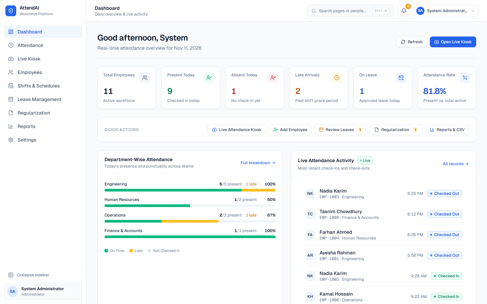

</div>

---

## ✨ Why AttendAI?

Most biometric attendance prototypes look like raw developer consoles—exposing thresholds, logs, and complicated workflows to HR teams and employees. **AttendAI** bridges enterprise AI computer vision with a calm, commercial-grade HR SaaS experience:

- **Zero Learning Curve:** Clean light-neutral interface with plain-language statuses, predictable navigation, and zero technical jargon on employee-facing screens.
- **Touchless Live Kiosk:** Dedicated full-screen camera terminal with live face framing, clear positioning guidance, instant photo/name check-in confirmation, and Web Audio + voice greetings.
- **Privacy-First Biometrics:** Raw camera images are discarded immediately after enrollment—only unit L2-normalized mathematical vectors (`128D` SFace embeddings) are stored.
- **Complete Workforce Operations:** End-to-end attendance tracking, shift & overnight rosters, leave approvals, side-by-side attendance regularization with audit trails, statutory CSV exports, and RBAC settings.

---

## 📸 Product Tour

### Live AI Attendance Kiosk
<p align="center">
  <sub>Real-time face framing, plain-language positioning guidance, instant photo confirmation, and audio greetings.</sub>
</p>
<p align="center">
  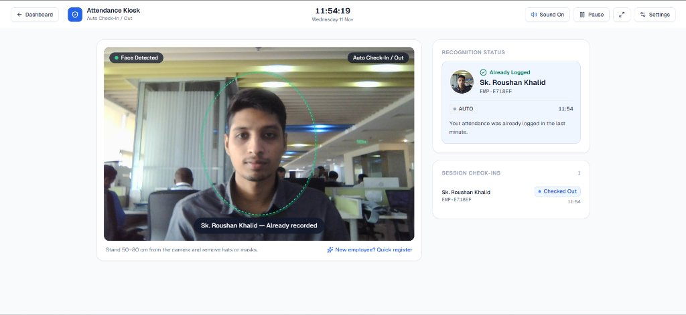
</p>

### Workforce Operations (Desktop)
<table>
  <tr>
    <td width="50%" valign="top" align="center">
      <strong>Attendance Management</strong><br />
      <sub>Today's attendance, history, late/early tracking &amp; missing punches.</sub>
      <br /><br />
      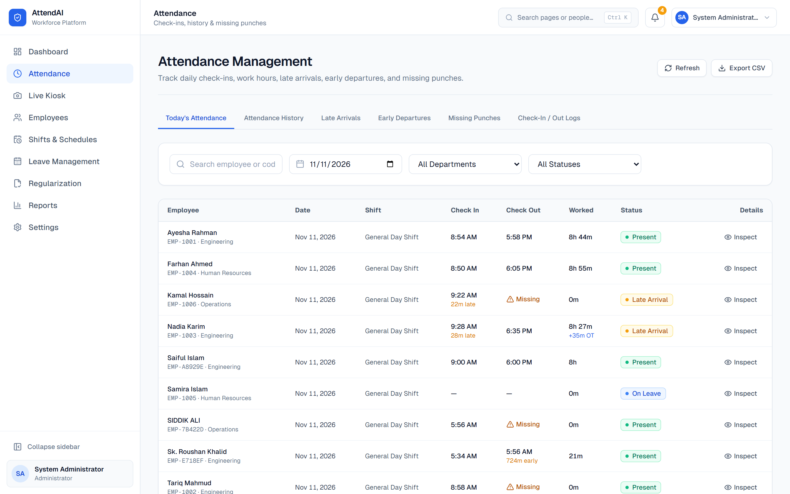
    </td>
    <td width="50%" valign="top" align="center">
      <strong>Employee Directory &amp; Face Setup</strong><br />
      <sub>Multi-facet filters, 2-step onboarding &amp; 3-angle face capture.</sub>
      <br /><br />
      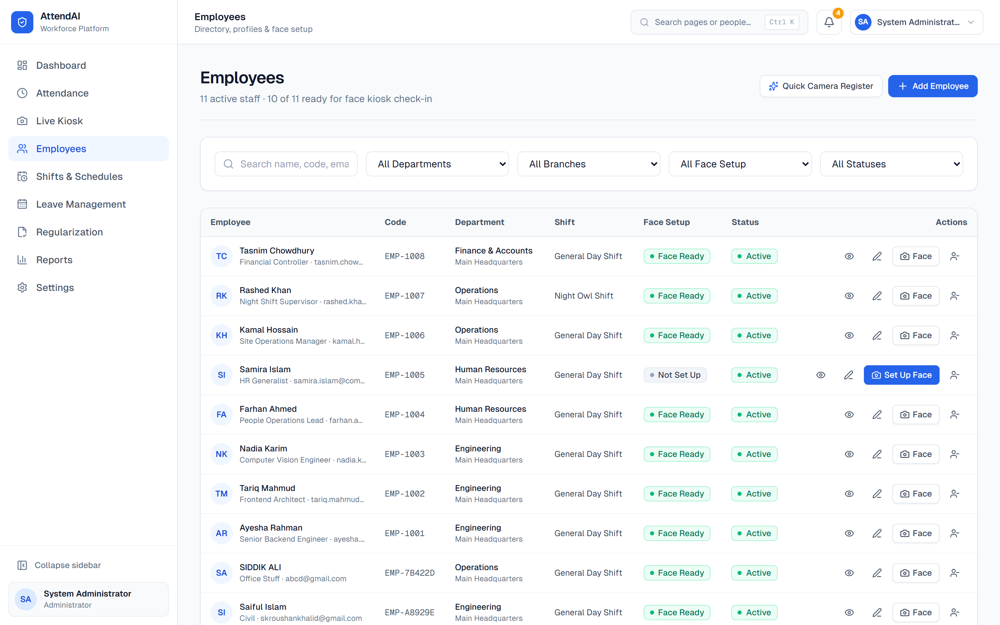
    </td>
  </tr>
  <tr>
    <td width="50%" valign="top" align="center">
      <strong>Shifts &amp; Schedules</strong><br />
      <sub>Day/overnight rosters, grace periods, breaks &amp; staff assignment.</sub>
      <br /><br />
      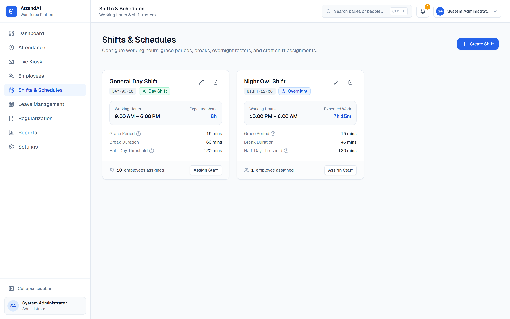
    </td>
    <td width="50%" valign="top" align="center">
      <strong>Leave Management &amp; Holidays</strong><br />
      <sub>Approval queues, YTD leave summaries &amp; branch holiday calendars.</sub>
      <br /><br />
      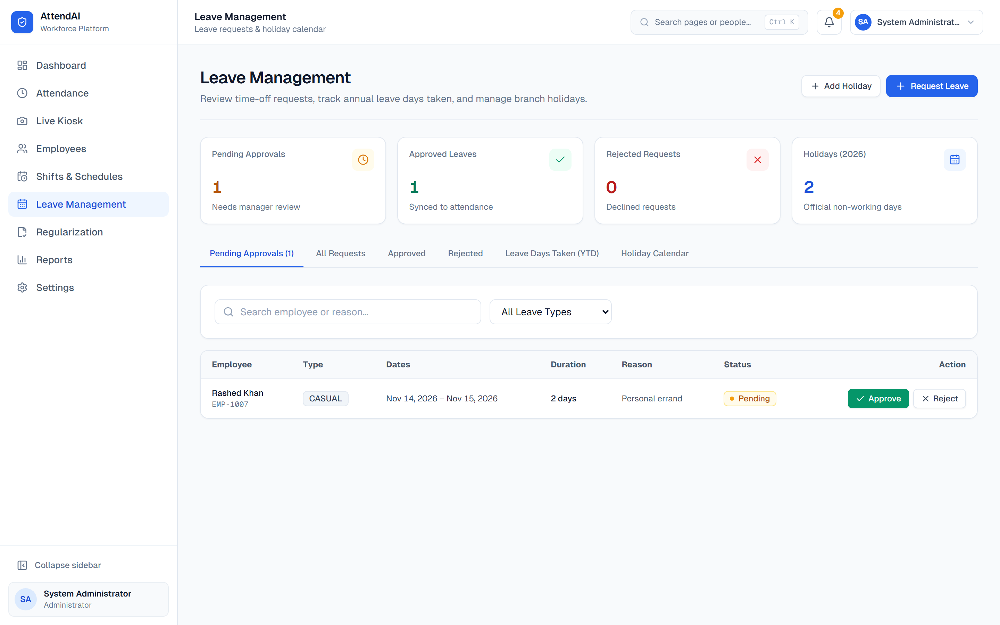
    </td>
  </tr>
  <tr>
    <td width="50%" valign="top" align="center">
      <strong>Attendance Regularization</strong><br />
      <sub>Side-by-side Original vs. Requested diffs &amp; immutable audit logs.</sub>
      <br /><br />
      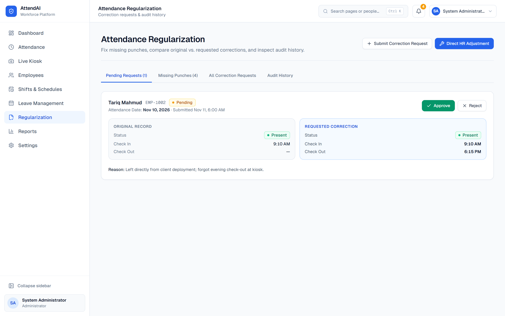
    </td>
    <td width="50%" valign="top" align="center">
      <strong>Reports &amp; Statutory CSV Export</strong><br />
      <sub>Daily, monthly, department &amp; overtime insights with CSV export.</sub>
      <br /><br />
      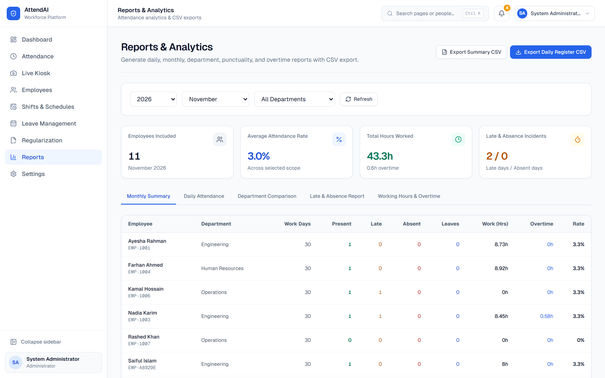
    </td>
  </tr>
  <tr>
    <td width="50%" valign="top" align="center">
      <strong>Organization, Users &amp; Kiosk Settings</strong><br />
      <sub>Role-gated branches, departments, user accounts &amp; preferences.</sub>
      <br /><br />
      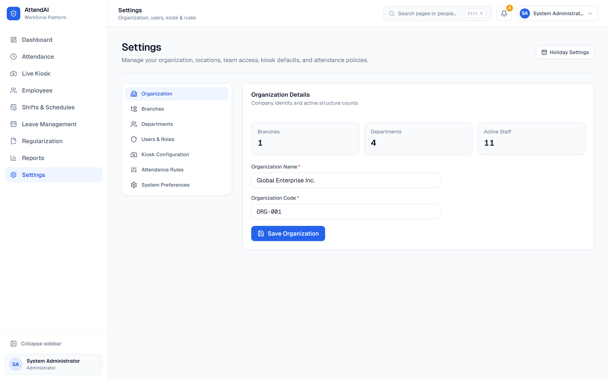
    </td>
    <td width="50%" valign="top" align="center">
      <strong>Sign In &amp; Direct Kiosk Access</strong><br />
      <sub>Clean authentication gate with instant terminal launch.</sub>
      <br /><br />
      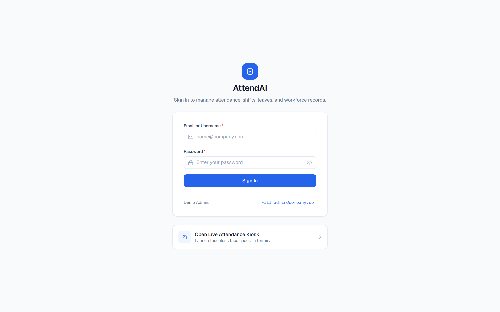
    </td>
  </tr>
</table>

### Mobile Responsive Experience
<table>
  <tr>
    <td width="33.3%" valign="top" align="center">
      <strong>Mobile Dashboard</strong><br />
      <sub>KPIs &amp; quick actions</sub>
      <br /><br />
      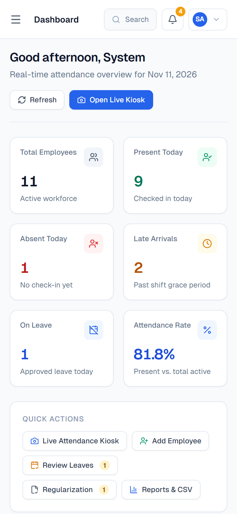
    </td>
    <td width="33.3%" valign="top" align="center">
      <strong>Mobile Attendance</strong><br />
      <sub>Filters &amp; check-in status</sub>
      <br /><br />
      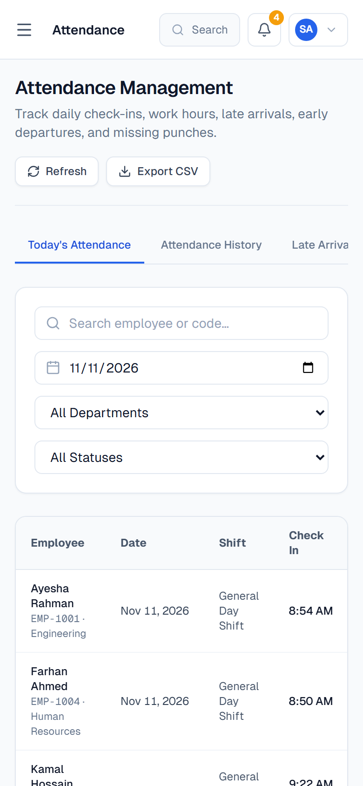
    </td>
    <td width="33.3%" valign="top" align="center">
      <strong>Mobile Regularization</strong><br />
      <sub>Correction diffs &amp; approvals</sub>
      <br /><br />
      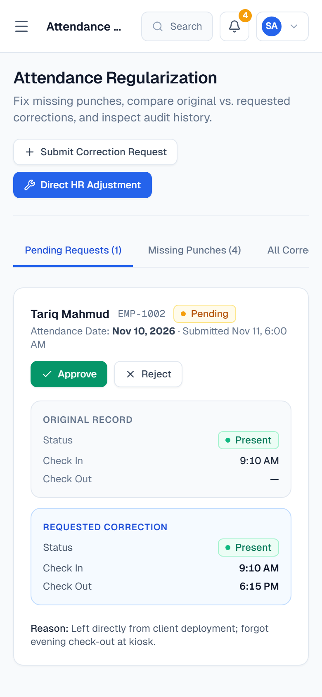
    </td>
  </tr>
</table>

---

## 🚀 Key Capabilities

| Module | Highlights |
| :--- | :--- |
| **Main Dashboard** | Live KPIs (Total, Present, Absent, Late, On Leave, Attendance Rate), quick actions, department stacked bars, and live punch stream |
| **Live Attendance Kiosk** | Continuous sequential camera loop, face alignment oval, instant confirmation card, 60s duplicate punch protection, audio/speech greetings, fullscreen mode, and supervisor config drawer |
| **Attendance Hub** | Views for Today, History, Late Arrivals, Early Departures, Missing Punches, and Raw Check-In/Out Logs with slide-over inspection and CSV export |
| **Employees & Face Setup** | Guided 2-step registration, quick 1-step camera register, profile drawer, edit drawer, status management, and 3-photo guided face enrollment with plain-language quality checks |
| **Shifts & Schedules** | Create/edit day and overnight shifts, configure grace period, half-day cutoff, and break minutes, and assign employees directly |
| **Leave Management** | Pending/Approved/Rejected workflows, automatic `ON_LEAVE` attendance sync, YTD leave days taken tracker, and branch holiday calendar |
| **Regularization & Audit** | Missing punch queue, employee correction requests, side-by-side Original vs. Requested diffs, HR overrides, and tamper-evident audit logs |
| **Reports & Analytics** | Daily, monthly, department comparison, late/absence, and overtime views plus statutory CSV downloads (Bangladesh Labour Act Form 9 / APPI) |
| **Settings** | Organization profile, branches, departments, RBAC user/role management, persisted kiosk defaults, and attendance rule preferences |

---

## 🧠 AI & System Architecture

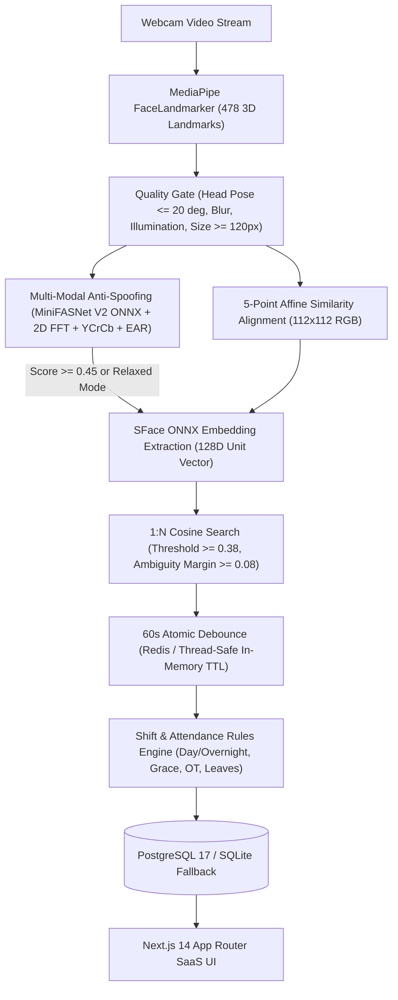

### Technology Stack
- **Frontend:** Next.js 14 (App Router), React 18, TypeScript 5, Tailwind CSS 3.4, Lucide Icons, Web Audio API, SpeechSynthesis
- **Backend:** FastAPI, Python 3.11, Pydantic V2, SQLAlchemy 2.0, JWT (`HS256`) + Bcrypt
- **Computer Vision:** MediaPipe FaceLandmarker Tasks API, OpenCV 4.10 (`face_recognition_sface.onnx`), ONNX Runtime 1.20 (`minifasnet_v2.onnx`), NumPy
- **Storage & Cache:** PostgreSQL 17 with automatic SQLite fallback (`attendance_dev.db`), Redis with thread-safe in-memory TTL fallback

---

## 🔐 Role-Based Experiences

| Role | Access Scope |
| :--- | :--- |
| **`ADMIN`** | Full organization, branches, departments, user accounts & roles, kiosk defaults, attendance rules, and all HR modules |
| **`HR_MANAGER`** | Employee directory, face setup, shifts, attendance management, leave & regularization approvals, reports, and holiday calendar |
| **`LINE_MANAGER`** | Team attendance, live kiosk, shift schedules, leave & regularization approvals, and team reports |
| **`EMPLOYEE`** | Personal dashboard ("My Attendance Today"), personal attendance history, personal leave requests & holiday calendar, and missing-punch correction requests |

---

## ⚡ Quick Start

### Prerequisites
- **Python 3.11+**
- **Node.js 18+** & npm
- **PostgreSQL 17** (optional — automatically falls back to SQLite if Postgres is unavailable)
- **Webcam** (for Live Kiosk & Face Setup)

### One-Command Startup (Windows PowerShell)

```powershell
# Start both Backend API (port 8000) and Frontend UI (port 3000)
powershell -ExecutionPolicy Bypass -File .\start-all.ps1

# Stop all services cleanly
powershell -ExecutionPolicy Bypass -File .\stop-all.ps1
```

### Manual Setup

<details>
<summary>Expand manual backend & frontend setup instructions</summary>

**1. Backend API**
```powershell
cd backend
pip install -r requirements.txt
python -c "from app.core.init_db import init_db; init_db()"
uvicorn app.main:app --host 0.0.0.0 --port 8000 --reload
```

**2. Frontend UI**
```powershell
cd frontend
npm install
npm run dev
```

</details>

### Default Endpoints & Credentials
- **Web App:** `http://localhost:3000`
- **Live Kiosk Terminal:** `http://localhost:3000/kiosk`
- **API Docs (Swagger):** `http://127.0.0.1:8000/api/v1/docs`
- **Default Admin Login:** `admin@company.com` / `admin123`

---

## 🧪 Automated Test Suite

Run the complete automated backend test suite covering API endpoints, computer vision alignment/embeddings/anti-spoofing, security, shifts, leaves, holidays, quick registration, regularization, reports, settings, and role-based access control:

```powershell
python -m pytest
```

**Test Coverage (21 tests across 9 suites):**
- `test_api_endpoints.py` — Health checks, auth login, employee lifecycle, face enrollment & debounce
- `test_computer_vision.py` — 112x112 alignment, L2 embedding normalization, cosine matching & anti-spoofing
- `test_database_and_security.py` — Password hashing, JWT tokens, seeded entities, TTL debounce cache
- `test_leaves_holidays.py` — Branch holiday calendar & leave approval attendance sync
- `test_quick_register.py` — 1-step camera quick registration & instant kiosk recognition
- `test_regularization.py` — Admin regularization & immutable audit log trail
- `test_reports.py` — Monthly aggregation & statutory CSV export
- `test_settings_and_requests.py` — Organization/settings APIs, correction request workflow & RBAC scoping
- `test_shifts.py` — Day/evening/overnight shift CRUD & auto-overnight detection

Frontend static checks:
```powershell
cd frontend
npx tsc --noEmit
npm run lint
npm run build
```

---

## 🛠️ Kiosk Diagnostics & Calibration

- **Unknown Face / Low Similarity:** OpenCV SFace uses `FACE_RECOGNITION_THRESHOLD=0.38` (`FACE_AMBIGUITY_MARGIN=0.08`) in `backend/.env`. Ensure the employee's face profile is set up under **Employees** and there are no duplicate accounts registered to the same face.
- **Screen Glare / Harsh Backlight:** Open **Settings** on the Kiosk header bar and switch **Lighting Tolerance** to **Relaxed Lighting Mode** for bright monitor reflections or indoor test environments.
- **Camera Positioning:** Stand 50–80 cm from the lens, keep head level within the guide oval, and wait ~0.5s for focus stabilization.
