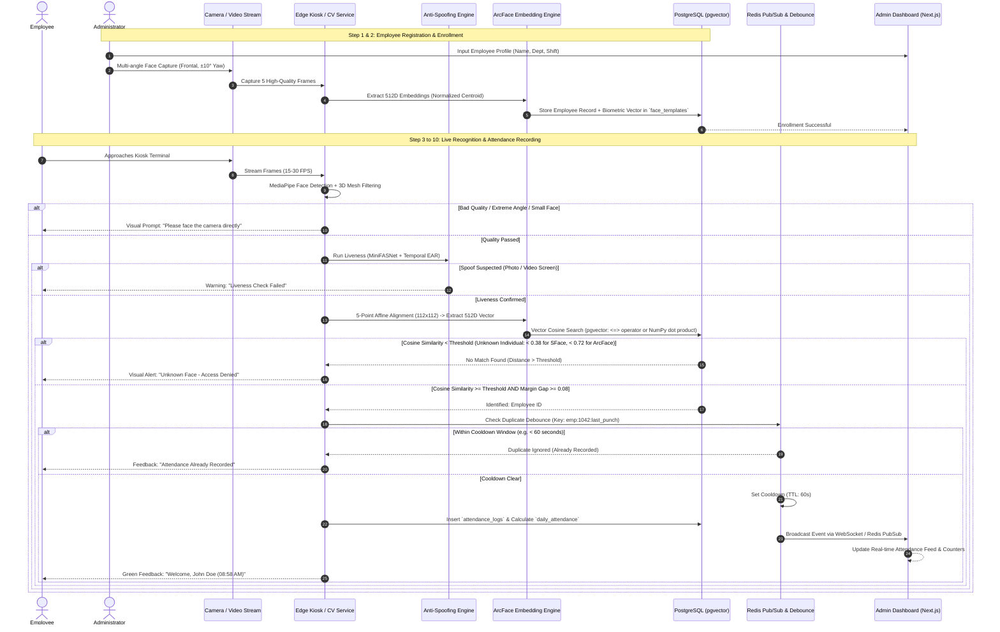
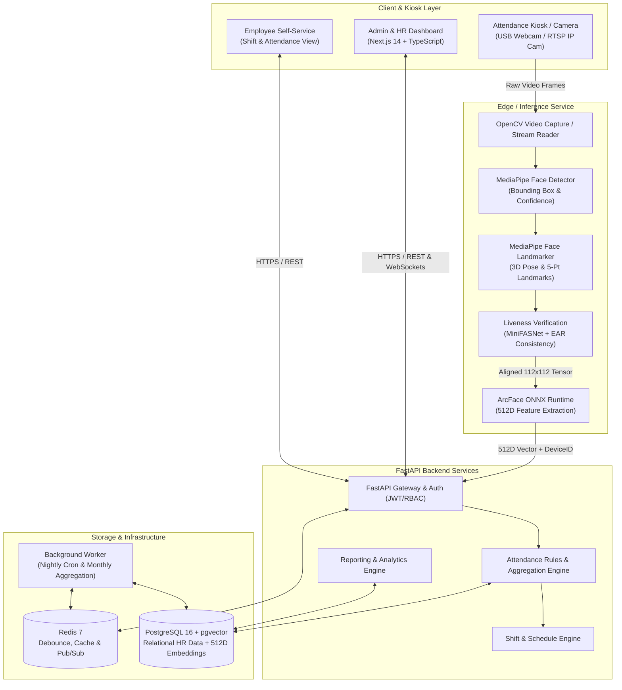
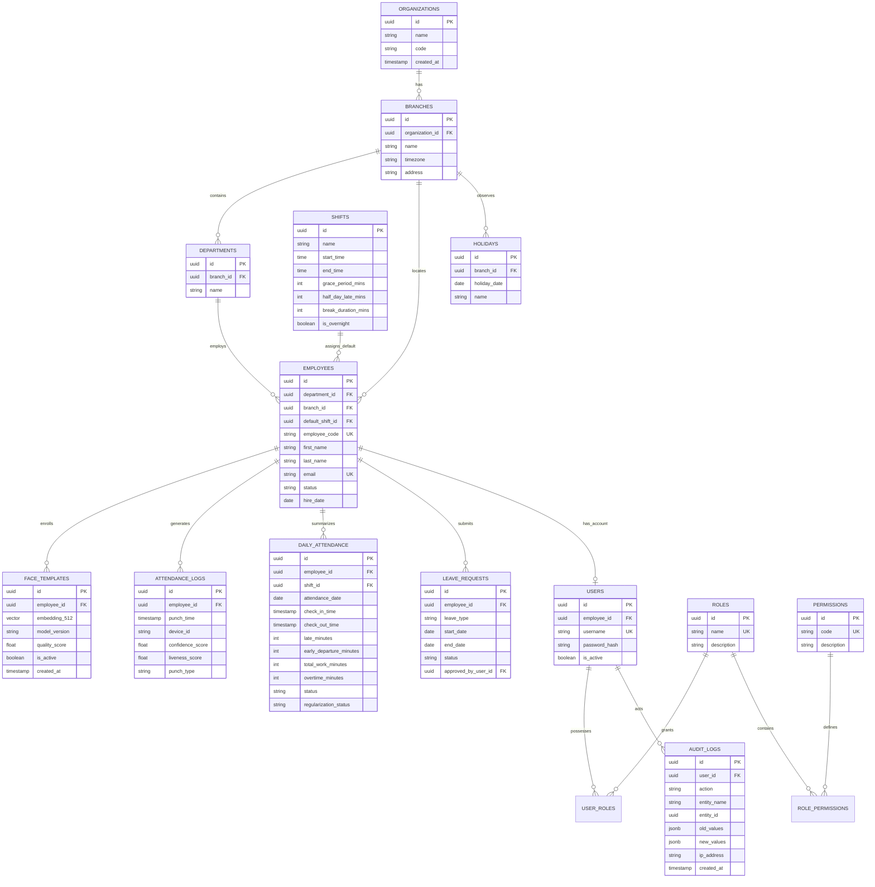

# PHASE 1: AI Face Recognition Attendance Management System
## Technical Feasibility, Research, & System Architecture Blueprint

**Document Version:** 1.0.0  
**Status:** Architectural Proposal (Pending User Approval)  
**Author:** Senior AI Engineer, Computer Vision Engineer, Product & Solution Architect  
**Project Workspace:** `AI-Attendace-Tracker`  

---

## Table of Contents
1. [Executive Summary & Technical Feasibility](#1-executive-summary--technical-feasibility)
2. [Technology Research & In-Depth Comparison](#2-technology-research--in-depth-comparison)
   - 2.1 Face Detection & Facial Landmarks
   - 2.2 Face Recognition & Embedding Models
   - 2.3 Anti-Spoofing & Liveness Detection
   - 2.4 Exact Role of MediaPipe in the Recognition Pipeline
   - 2.5 Technology Comparison Matrix
3. [Attendance Workflow & Pipeline Architecture](#3-attendance-workflow--pipeline-architecture)
   - 3.1 End-to-End Operational Workflow
   - 3.2 Unknown Face Handling & Rejection Mechanics
   - 3.3 Duplicate Punch Debouncing & Cooldown Strategy
4. [Configurable Attendance Business Rules Engine](#4-configurable-attendance-business-rules-engine)
   - 4.1 Check-In & Check-Out Determination
   - 4.2 Grace Periods, Late Arrival & Early Departure
   - 4.3 Working Hours, Breaks & Overtime
   - 4.4 Shift Management & Midnight Crossings
   - 4.5 Holidays, Leave Integration & Missing Attendance
5. [Recommended Technology Stack & System Architecture](#5-recommended-technology-stack--system-architecture)
   - 5.1 Component Evaluations
   - 5.2 Recommended Architecture & Tech Stack
   - 5.3 System Architecture Diagram
   - 5.4 Face Recognition Pipeline Diagram
   - 5.5 Attendance State Machine Diagram
6. [Database Design & Data Models](#6-database-design--data-models)
   - 6.1 Entity-Relationship (ER) Diagram
   - 6.2 Data Dictionary & Schema Specifications
7. [Hardware & Deployment Sizing](#7-hardware--deployment-sizing)
   - 7.1 Camera & Optical Setup
   - 7.2 Edge Device vs. Server Compute Sizing
8. [Privacy, Compliance & Biometric Security](#8-privacy-compliance--biometric-security)
   - 8.1 Biometric Data Protection Principles
   - 8.2 Jurisdictional Analysis: Bangladesh
   - 8.3 Jurisdictional Analysis: Japan (APPI)
   - 8.4 Cryptographic Template Security & RBAC
   - 8.5 Legal Questions for Professional Review
9. [MVP Feature Scope vs. Post-MVP Vision](#9-mvp-feature-scope-vs-post-mvp-vision)
10. [Development Roadmap (Phased Execution)](#10-development-roadmap-phased-execution)

---

## 1. Executive Summary & Technical Feasibility

### 1.1 Objective
The objective is to design a robust, enterprise-grade, conventional **Employee Attendance Management System** driven by computer vision and deep learning face recognition. The system automates attendance logging at designated check-in points (e.g., office entrances, kiosk terminals) using standard webcams or RTSP/USB cameras, completely eliminating manual logbooks, punch cards, and fingerprint scanners.

> [!IMPORTANT]
> **Scope Boundary Enforcement:**
> In accordance with core product constraints, this system **strictly records static attendance events at designated terminals/cameras**. It does **not** perform door movement tracking, entrance/exit direction detection, trajectory pathing, or repeated door-crossing spatial analytics.

### 1.2 Critical Facts vs. Assumptions

| Domain | Verified Fact | Working Assumption | Risk & Mitigation |
| :--- | :--- | :--- | :--- |
| **MediaPipe Scope** | MediaPipe BlazeFace/FaceMesh performs detection and 3D landmark regression; it **does NOT generate face recognition embeddings**. | Landmark alignment from MediaPipe is accurate enough to serve as the input normalization stage for ArcFace. | **Low Risk.** 5 canonical keypoints extracted from MediaPipe FaceMesh provide sub-millimeter affine alignment. |
| **Face Recognition** | ArcFace (Additive Angular Margin Loss) achieves state-of-the-art cosine margin separation (>99.5% LFW accuracy). | Pretrained models can run inference in under 30ms on modern x86/ARM CPUs using ONNX Runtime. | **Medium Risk.** Model size vs. latency tradeoff. MobileFaceNet (4MB) provides sub-15ms CPU inference; ResNet-50 requires ~60ms on CPU or GPU acceleration. |
| **Camera Hardware** | Standard RGB webcams lack hardware depth (IR/Structured Light/ToF), making passive 2D anti-spoofing challenging. | Office environment has controlled lighting (300–700 lux) and users face the camera within 0.5–1.5 meters. | **Medium-High Risk.** High-res screen replays can fool basic RGB passive models. Mitigation: Multi-frame temporal consistency + EAR blink check + MiniFASNet CNN. |
| **Database & Search** | PostgreSQL with `pgvector` can perform exact (HNSW/IVFFlat) cosine similarity queries on 512D vectors in < 2ms for up to 50,000 employees. | Standalone vector databases (Milvus, Pinecone, Qdrant) are unnecessary at SMB/enterprise scale (<10,000 staff). | **Zero Risk.** Eliminates dual-database synchronization overhead; single transaction guarantees ACID compliance. |
| **Legal Status** | Biometric face templates are classified as "Sensitive Personal Data" (Japan APPI: *Special Care-Required Personal Information*). | Employees will execute written/digital consent during enrollment; non-biometric alternative is mandatory. | **High Risk.** Legal counsel must validate employee consent forms and biometric retention rules in Bangladesh and Japan. |

---

## 2. Technology Research & In-Depth Comparison

### 2.1 Face Detection & Facial Landmarks

```
+----------------------------------------------------------------------------------------------------+
|                                    FACE PROCESSING PIPELINE                                        |
|                                                                                                    |
|  [Raw Video Frame]                                                                                 |
|         │                                                                                          |
|         ▼                                                                                          |
|  ┌───────────────┐        ┌─────────────────────────┐        ┌──────────────────────────────────┐  |
|  │ MediaPipe     │ BBox   │ MediaPipe FaceLandmarker│ 468    │ Canonical 5-Point Extraction &   │  |
|  │ Face Detector ├───────►│ (468/478 3D Mesh)       ├───────►│ Similarity Transform (112x112)   │  |
|  └───────────────┘        └─────────────────────────┘        └──────────────────────────────────┘  |
+----------------------------------------------------------------------------------------------------+
```

#### MediaPipe Face Detector (BlazeFace)
- **Architecture:** Lightweight Single Shot Detector (SSD) optimized for mobile/web GPU/CPU with custom anchors.
- **Latency:** 3–8 ms on CPU (Intel Core i5/i7 or Apple Silicon).
- **Output:** Bounding box + 6 basic keypoints (right eye, left eye, nose tip, mouth center, right ear tragion, left ear tragion).
- **Pros:** Blazing fast; robust to distance variations up to 2 meters; handles occlusions reasonably well.
- **Cons:** Bounding box alone does not provide enough geometric fidelity for non-frontal face normalization.

#### MediaPipe Face Landmarker (Face Mesh)
- **Architecture:** Two-stage cascaded deep network predicting 468 (or 478 with iris) 3D surface landmarks.
- **Latency:** 8–18 ms on CPU.
- **Role:**
  1. **Head Pose Estimation:** Computes Yaw, Pitch, and Roll using Perspective-n-Point (PnP) or landmark regression. Faces turned beyond $\pm 20^\circ$ yaw or $\pm 15^\circ$ pitch are rejected upfront.
  2. **Eye Aspect Ratio (EAR):** Tracks eye blinks over consecutive frames for dynamic liveness.
  3. **High-Precision Alignment:** Extracts exact coordinates for:
     - Left Pupil / Eye Center (Landmark indices: 468 or 33, 133 mean)
     - Right Pupil / Eye Center (Landmark indices: 473 or 362, 263 mean)
     - Nose Tip (Landmark index: 1)
     - Left Mouth Corner (Landmark index: 61)
     - Right Mouth Corner (Landmark index: 291)

#### OpenCV Face Detection Modules
- **Haar Cascades:** Legacy (2001). Extreme false positives under uneven office lighting; highly sensitive to rotation. Disqualified for production.
- **OpenCV DNN (ResNet-10 SSD):** Accurate, but heavier and lacks the dense facial mesh required for quality assessment and liveness checks.
- **OpenCV YuNet:** Modern, fast ONNX-based detector with 5 landmarks. While performant, it does not provide 3D head pose estimation or dense mesh landmarks for anti-spoofing.

### 2.2 Face Recognition & Embedding Models

Face recognition converts an aligned $112 \times 112$ RGB face image into a compact, unit-normalized feature vector (embedding) $\mathbf{v} \in \mathbb{R}^{d}$ where $d \in \{128, 512\}$. Recognition is evaluated by cosine similarity:
$$\text{Cosine Similarity}(\mathbf{u}, \mathbf{v}) = \frac{\mathbf{u} \cdot \mathbf{v}}{\|\mathbf{u}\|_2 \|\mathbf{v}\|_2} = \mathbf{u} \cdot \mathbf{v} \quad (\text{if normalized})$$

```
+--------------------------------------------------------------------------------------------------+
| Model             | Embedding Dim | LFW Acc  | CPU Latency (ONNX) | License        | Commercial? |
+-------------------+---------------+----------+--------------------+----------------+-------------+
| ArcFace (ResNet50)| 512D          | 99.83%   | 45 - 65 ms         | MIT (Code)     | Model Dep.  |
| MobileFaceNet     | 128D / 512D   | 99.50%   | 10 - 18 ms         | MIT / Apache2  | YES (Open)  |
| FaceNet (IncResv1)| 512D          | 99.20%   | 50 - 80 ms         | Apache 2.0     | YES         |
| AdaFace (IR-50)   | 512D          | 99.82%   | 50 - 70 ms         | MIT            | Research*   |
| InsightFace SDK   | 512D          | 99.80%+  | Model Dependent    | Non-Commercial | RESTRICTED* |
+--------------------------------------------------------------------------------------------------+
```

> [!WARNING]
> **InsightFace Licensing Reality Check:**
> The DeepInsight / InsightFace codebase itself is MIT-licensed, but **their pre-trained models (e.g., `buffalo_l`, `antelopev2`, Glint360k-trained weights) are strictly non-commercial research use only**.
> **Architectural Solution:** For commercial compliance, our system must use **ArcFace or MobileFaceNet backbones trained on commercially permissive datasets** (such as CASIA-WebFace or synthetically generated datasets) or export open Apache 2.0 / MIT ONNX weights.

### 2.3 Anti-Spoofing & Liveness Detection

Standard RGB attendance kiosks face three major presentation attacks (PAD - Presentation Attack Detection):
1. **2D Print Attack:** Photo printed on matte/glossy paper.
2. **2D Video Replay Attack:** Smartphone, tablet, or laptop displaying a recorded video.
3. **3D Cutout / Mask Attack:** Printed mask with eye cutouts.

#### Multi-Tiered Anti-Spoofing Architecture

```
                 [Incoming Face Crop & Landmark Stream]
                                   │
                 ┌─────────────────┴─────────────────┐
                 ▼                                   ▼
      [Tier 1: Geometric & Temporal]     [Tier 2: Deep Texture CNN]
      - MediaPipe EAR (Blink over time)   - MiniFASNetV2 (ONNX)
      - Head Pose Variation (Yaw/Pitch)   - Multi-scale Fourier Spectrum
      - Micro-movement Optical Flow       - Moire Pattern / Screen Glare
                 │                                   │
                 └─────────────────┬─────────────────┘
                                   │
                                   ▼
                 [Liveness Fusion Score (0.0 - 1.0)]
                 If Score >= 0.85 -> PASS to ArcFace
                 If Score <  0.85 -> REJECT ("Spoof Detected")
```

1. **Passive Liveness (MiniFASNet / Silent-Face-Anti-Spoofing):**
   - Lightweight MobileNet-style architecture operating on multi-scale crops (full face + patch).
   - Examines high-frequency specular reflections, Moire fringes, and display pixel rasterization.
   - Inference latency: ~15ms on CPU.
2. **Dynamic / Temporal Consistency Gate:**
   - Evaluates a rolling buffer of 5–10 frames.
   - Requires natural biometric micro-jitter; a static photo held completely still will exhibit near-zero optical flow variance across landmarks, triggering rejection.
   - Passive blink detection via MediaPipe Eye Aspect Ratio (EAR) without annoying the user with active prompts.

### 2.4 How MediaPipe Fits into the Recognition Pipeline

MediaPipe is **not** an alternative to ArcFace; rather, it is the **indispensable pre-processing and quality-assurance gatekeeper**:

```
[Raw Frame]
     │
     ├─► 1. Detection (MediaPipe BlazeFace): Fast face localization, reject if no face.
     │
     ├─► 2. Mesh & Pose (MediaPipe FaceLandmarker):
     │      ├─ Compute 3D Head Pose (Yaw, Pitch, Roll).
     │      ├─ Compute Face Bounding Size (Must exceed 120x120 pixels).
     │      ├─ Compute Eye Aspect Ratio (EAR) for liveness tracking.
     │      └─ Rejection Gate: Reject if pose > 20 deg, blur detected, or face too small.
     │
     ├─► 3. Geometric Alignment:
     │      └─ Extract canonical 5 landmark points (eyes, nose, mouth corners).
     │      └─ Compute 2D Affine Similarity Transformation matrix.
     │      └─ Warp & Crop to standardized 112x112 RGB tensor.
     │
     └─► 4. Handoff to Deep Recognition:
            └─ Aligned 112x112 tensor feeds directly into ArcFace / MobileFaceNet ONNX.
```

---

## 3. Attendance Workflow & Pipeline Architecture

### 3.1 End-to-End Operational Workflow



### 3.2 Unknown Face Handling & Rejection Mechanics
To guarantee that **unknown faces are never assigned to registered employees**:
1. **Calibrated Cosine Similarity Threshold ($T_{\text{match}}$):**
   - **OpenCV SFace (SphereFace 128D):** Configured at $\ge 0.38$ (OpenCV Zoo official criterion: $\ge 0.363$). Under typical webcam lighting, same-individual cosine similarity ranges between $0.45$ and $0.95$, while different individuals stay below $0.25$.
   - **ArcFace / InsightFace (512D):** Threshold configured at $\ge 0.72$ (equivalent to L2 distance $\le 0.75$).
   - Any query returning a maximum similarity $< T_{\text{match}}$ is immediately categorized as `UNKNOWN_PERSON`.
2. **Ambiguity Margin Gap Rule ($\Delta_{\text{margin}}$):**
   - If the top match score is $S_1$ and the second-highest match for a *different employee* is $S_2$, the system enforces:
     $$\Delta = S_1 - S_2 \ge 0.08$$
   - If $\Delta < 0.08$ and $S_2 \ge T_{\text{match}}$, the match is flagged as ambiguous (e.g., twins, lookalikes, or duplicate enrollments of the same person) and verification is safely rejected to prevent false attribution.
3. **Multi-Modal Anti-Spoofing Gate ($T_{\text{liveness}}$):**
   - Evaluates presentation attack likelihood combining MiniFASNet V2 deep texture logits (standard $[0.0, 1.0]$ tensor scaling), high-frequency 2D FFT spectrum, multi-ethnic YCrCb skin chroma, and MediaPipe Eye Aspect Ratio (EAR).
   - Calibrated default threshold: $0.45$.
   - Offers an operator-selectable **Office / Bypass Mode** for controlled environments or webcams suffering from intense monitor glare.
4. **Audit of Unknown Encounters:**
   - Unknown encounters do not create attendance logs. Optionally, a security event log is created with timestamp and device ID (without saving personal data).

### 3.3 Duplicate Punch Debouncing & Cooldown Strategy
When an employee stands in front of the camera for 5 seconds, the camera captures ~150 frames. To prevent spamming the database:
- **In-Memory Redis Debounce Lock:**
  - Key: `attendance:debounce:{employee_id}`
  - TTL: Configurable (default: **60 seconds**).
  - When a recognition event passes verification, the system executes an atomic `SET key val EX 60 NX`. If the key exists, the backend skips database insertion and returns a friendly "Already Checked In" status to the client terminal.

---

## 4. Configurable Attendance Business Rules Engine

The system strictly decouples **raw physical scan events** (`attendance_logs`) from **business interpretation** (`daily_attendance`).

```
[Raw Camera Punches] ──► [Daily Aggregator Engine] ──► [Daily Attendance Status]
(Physical Timestamps)     (Applies Rules & Shifts)     (PRESENT, LATE, OVERTIME, etc.)
```

### 4.1 Check-In & Check-Out Determination
The system supports three configurable operational modes:
1. **First-In / Last-Out Mode (Default):**
   - The first valid punch of the calendar day (or shift window) is recorded as `actual_check_in`.
   - The last valid punch of the day/shift is continuously updated as `actual_check_out`.
   - Any intermediate punches are preserved in `attendance_logs` as audit records.
2. **Explicit Kiosk Mode:**
   - The user selects "Check-In" or "Check-Out" on a touch kiosk before facial scan.
3. **Shift-Window Auto-Determination:**
   - Scans within $[-60\text{ min}, +120\text{ min}]$ of Shift Start are classified as Check-In.
   - Scans within $[-60\text{ min}, +240\text{ min}]$ of Shift End are classified as Check-Out.

### 4.2 Grace Periods, Late Arrival & Early Departure

```
  Shift Start: 09:00 AM                        Shift End: 06:00 PM
         │                                              │
 ────────┼───────────────┬──────────────────────────────┼───────────────►
     On-Time       Grace Period: +15m                 Early Leave
  (Before 09:00)  (09:01 - 09:15)                  (Before 05:45 PM)
                   [No Penalty]
                                   Late Arrival
                                  (After 09:15 AM)
```

- **Grace Period ($G$):** Configurable per shift (e.g., 15 minutes).
  - Check-in at 09:12 AM (Shift: 09:00 AM) $\to$ Status: `PRESENT`, Late Minutes: `0`.
  - Check-in at 09:25 AM $\to$ Status: `LATE`, Late Minutes: `25`.
- **Half-Day Cutoff Threshold ($T_{\text{half}}$):**
  - If `actual_check_in` exceeds Shift Start by $> 120$ minutes, status automatically defaults to `HALF_DAY`.
- **Early Departure:**
  - If `actual_check_out` is earlier than Shift End minus Grace Departure (e.g., 15 min), flag `EARLY_DEPARTURE` and compute `early_leave_minutes`.

### 4.3 Working Hours, Breaks & Overtime
- **Gross Duration:** $\text{Gross} = \text{CheckOut} - \text{CheckIn}$.
- **Break Options:**
  - *Standard Auto-Deduction:* Automatically deducts configured break (e.g., 60 minutes lunch) if Gross duration $> 5$ hours.
  - *Punch-Based Breaks:* Tracks explicit break-out and break-in punches.
- **Net Work Duration:** $\text{Net} = \max(0, \text{Gross} - \text{Break})$.
- **Overtime Calculation:**
  - Overtime triggers only after `actual_check_out` exceeds Shift End + Minimum OT Threshold (e.g., 30 minutes).
  - $\text{Overtime Minutes} = \text{CheckOut} - \text{ShiftEnd}$.
  - Requires configurable toggle: `auto_approve_overtime` vs. `manager_approval_required`.

### 4.4 Shift Management & Midnight Crossings
- **Standard Day Shift:** e.g., 09:00 to 18:00 (same calendar date).
- **Overnight / Graveyard Shift:** e.g., 22:00 to 06:00 (crosses midnight).
  - *Rule Engine Logic:* A punch occurring at 05:55 AM on Tuesday for an employee assigned to Monday's 22:00 shift must be linked to **Monday's attendance record**.
  - *Solution:* The shift entity carries an `is_overnight: Boolean` flag and a `shift_day_boundary: Time` (e.g., 12:00 PM). Punches prior to the boundary belong to the preceding calendar shift assignment.

### 4.5 Holidays, Leave Integration & Missing Attendance
- **Leave Precedence:** If an approved leave record exists in `leave_records` for Date $D$, the daily record is pre-populated as `ON_LEAVE`. A missing punch on this day triggers **no absenteeism penalty**.
- **Holiday Engine:** Tracks Branch-specific holidays. If an employee punches on a public holiday or designated weekend, the system records `WORKED_ON_HOLIDAY` for special compensation/overtime calculation.
- **Missing Attendance Evaluator (Nightly Cron):**
  - Runs at 23:59 (or post shift cutoff).
  - If an employee has no punch, no leave, and it is a working day $\to$ mark as `ABSENT`.
  - If an employee has `CheckIn` but no `CheckOut` $\to$ mark as `INCOMPLETE_RECORD` (triggers notification for HR regularization).

---

## 5. Recommended Technology Stack & System Architecture

### 5.1 Component Evaluations

| Tier | Candidate Options | Recommendation | Justification |
| :--- | :--- | :--- | :--- |
| **Vision & AI** | OpenCV, Dlib, MediaPipe, DeepFace, InsightFace | **MediaPipe + ArcFace (ONNX Runtime)** | MediaPipe provides the fastest CPU-based landmark mesh & pose estimation; ArcFace ONNX gives state-of-the-art embedding accuracy with high-speed CPU/GPU execution. |
| **Backend API** | Node.js/Express, Go/Gin, Django, FastAPI | **FastAPI (Python 3.11+)** | High performance async I/O, native integration with AI/CV libraries (NumPy, ONNX), automatic OpenAPI/Swagger docs, and Pydantic validation. |
| **Frontend** | React SPA, Vue, Next.js (TypeScript) | **Next.js 14+ (App Router, TS)** | Server-side rendering, robust dashboard ecosystem, fast real-time updates via WebSockets/SSE, and enterprise UI components (Tailwind + Shadcn UI). |
| **Database** | MySQL, MongoDB, PostgreSQL + Pinecone, PostgreSQL + pgvector | **PostgreSQL 16 + `pgvector`** | Keeps relational enterprise HR data and 512D biometric vectors in a single ACID-compliant database. Zero sync delay; vector search in < 2ms via HNSW index. |
| **Cache & Queue** | RabbitMQ, Kafka, Redis | **Redis 7** | Sub-millisecond punch debouncing, real-time WebSocket pub/sub broadcasting, and background job queue brokering. |
| **Background Jobs** | Celery, APScheduler, ARQ | **ARQ or Celery (with Redis)** | Asynchronous aggregation of attendance summaries, scheduled reports, and nightly absenteeism cron tasks. |

### 5.2 Recommended Architecture & Tech Stack Summary

```
┌────────────────────────────────────────────────────────────────────────┐
│                        NEXT.JS 14 FRONTEND                             │
│   - Admin Dashboard & Analytics (Tailwind, Shadcn UI, Recharts)        │
│   - Employee Registration & Enrollment Module                          │
│   - Optional WebRTC Browser Kiosk Terminal                             │
└──────────────────────────────────┬─────────────────────────────────────┘
                                   │ HTTPS / WSS
                                   ▼
┌────────────────────────────────────────────────────────────────────────┐
│                        FASTAPI BACKEND CORE                            │
│   - RESTful API & WebSocket Gateway                                    │
│   - Auth: JWT + RBAC (Admin, HR, Manager, Employee)                    │
│   - Attendance Business Rules & Shift Engine                           │
│   - Vector Search Manager (Cosine Metric)                              │
└──────┬───────────────────────────┬───────────────────────────────┬─────┘
       │                           │                               │
       ▼                           ▼                               ▼
┌──────────────┐          ┌───────────────────┐          ┌───────────────┐
│  POSTGRESQL  │          │   REDIS CACHE &   │          │  BACKGROUND   │
│  16 +        │          │   PUB/SUB         │          │  WORKER       │
│  PGVECTOR    │          │ - Punch Debounce  │          │  (ARQ/Celery) │
│ - HR Schema  │          │ - Live Events WSS │          │ - Nightly Agg │
│ - 512D Embed │          │ - Token Blacklist │          │ - Leave Sync  │
└──────────────┘          └───────────────────┘          └───────────────┘
```

### 5.3 System Architecture Diagram



---

## 6. Database Design & Data Models

### 6.1 Entity-Relationship (ER) Diagram



### 6.2 Data Dictionary & Schema Specifications

#### Key Table: `face_templates`
```sql
CREATE EXTENSION IF NOT EXISTS vector;

CREATE TABLE face_templates (
    id UUID PRIMARY KEY DEFAULT gen_random_uuid(),
    employee_id UUID NOT NULL REFERENCES employees(id) ON DELETE CASCADE,
    embedding vector(512) NOT NULL, -- 512-dimensional ArcFace embedding
    model_version VARCHAR(50) NOT NULL DEFAULT 'arcface_r50_v1',
    quality_score REAL NOT NULL,
    is_active BOOLEAN NOT NULL DEFAULT TRUE,
    created_at TIMESTAMPTZ NOT NULL DEFAULT NOW()
);

-- Fast Cosine Similarity Index via HNSW
CREATE INDEX idx_face_templates_embedding_cosine 
ON face_templates USING hnsw (embedding vector_cosine_ops)
WITH (m = 16, ef_construction = 64);
```

#### Key Table: `daily_attendance`
```sql
CREATE TYPE attendance_status_enum AS ENUM (
    'PRESENT', 'LATE', 'HALF_DAY', 'EARLY_DEPARTURE', 
    'ABSENT', 'ON_LEAVE', 'HOLIDAY', 'WEEKLY_OFF'
);

CREATE TABLE daily_attendance (
    id UUID PRIMARY KEY DEFAULT gen_random_uuid(),
    employee_id UUID NOT NULL REFERENCES employees(id),
    shift_id UUID NOT NULL REFERENCES shifts(id),
    attendance_date DATE NOT NULL,
    check_in_time TIMESTAMPTZ,
    check_out_time TIMESTAMPTZ,
    late_minutes INT DEFAULT 0,
    early_departure_minutes INT DEFAULT 0,
    total_work_minutes INT DEFAULT 0,
    overtime_minutes INT DEFAULT 0,
    status attendance_status_enum NOT NULL DEFAULT 'ABSENT',
    regularization_status VARCHAR(20) DEFAULT 'NONE',
    created_at TIMESTAMPTZ DEFAULT NOW(),
    updated_at TIMESTAMPTZ DEFAULT NOW(),
    CONSTRAINT uq_employee_date UNIQUE (employee_id, attendance_date)
);
```

---

## 7. Hardware & Deployment Sizing

### 7.1 Camera & Optical Requirements
- **Resolution:** 1080p (1920 $\times$ 1080) @ 30 FPS or 720p (1280 $\times$ 720) @ 30 FPS minimum.
- **Sensor:** Wide Dynamic Range (WDR $\ge 100\text{ dB}$) is strongly recommended to handle backlight glare when terminals face glass doors or windows.
- **Field of View (FOV):** $70^\circ$ to $90^\circ$ diagonal FOV; capture range 0.5m to 1.5m.
- **Illumination:** Minimum 250–300 lux. In dim entrance corridors, supplementary diffuse LED ring lighting should be added.

### 7.2 Hardware Compute Sizing Options

```
┌────────────────────────────────────────────────────────────────────────┐
│ Option A: Edge Kiosk (Recommended for Zero-Latency Local Terminals)    │
│ Hardware: Intel N100 / Core i3 Mini PC or NVIDIA Jetson Orin Nano      │
│ - Runs MediaPipe + MobileFaceNet ONNX locally on CPU / NPU             │
│ - Frame Processing Latency: ~25 ms                                     │
│ - Bandwidth Consumption: Minimal (sends only 512D vectors or events)   │
└────────────────────────────────────────────────────────────────────────┘

┌────────────────────────────────────────────────────────────────────────┐
│ Option B: Centralized Server (Browser Kiosk or RTSP Ingestion)         │
│ Hardware: Quad-Core Xeon / AMD EPYC + Optional NVIDIA T4 / RTX 4060    │
│ - Cameras stream RTSP to centralized CV worker                         │
│ - Easy centralized model upgrades; higher network bandwidth demand     │
│ - Server Sizing: 1 CPU Core per 2 camera streams (without GPU)         │
└────────────────────────────────────────────────────────────────────────┘
```

---

## 8. Privacy, Compliance & Biometric Security

### 8.1 Biometric Data Protection Principles
Unlike passwords, **human faces cannot be reset if compromised**.
1. **Never Store Raw Face Images in Primary DB:**
   - The operational database stores **only irreversible, mathematical 512D vector embeddings**.
   - Raw enrollment photos (if retained for administrative audit) must be stored in a separate, encrypted object store with zero public access.
2. **One-Way Embeddings:**
   - An ArcFace embedding cannot be directly reconstructed into the original face photo without deep feature inversion networks (which produce only coarse approximations).

### 8.2 Jurisdictional Analysis: Bangladesh

| Legal Instrument | Mandates & Applicability | Implementation in System |
| :--- | :--- | :--- |
| **Cybersecurity Act 2023 & ICT Act (Amended 2013)** | Requires unauthorized access prevention, data integrity, and protection of electronic records. | TLS 1.3 encryption in transit, AES-256 for template storage at rest, and tamper-evident audit logs. |
| **Draft Data Protection Act (PDPA Bangladesh)** | Classifies biometric data as sensitive personal data; requires clear purpose limitation, data minimization, and explicit consent. | Digital consent timestamp recorded at enrollment; strict purpose limitation ("Workplace Attendance Only"). |
| **Bangladesh Labour Act 2006** | Mandates statutory attendance registers (Form 9), statutory working hours (8 hrs/day, 48 hrs/week), and overtime tracking. | System generates standard Form 9 compliant export reports and tracks statutory overtime calculations. |

### 8.3 Jurisdictional Analysis: Japan (APPI - 個人情報保護法)

Under Japan's **Act on the Protection of Personal Information (APPI)**, facial recognition data constitutes **"Special Care-Required Personal Information" (要配慮個人情報 - You-hairyo Kojin Jouhou)**:

```
+--------------------------------------------------------------------------------------------------+
| APPI Statutory Requirement               | System Architecture Compliance Measure                |
+------------------------------------------+-------------------------------------------------------+
| 1. Explicit Prior Consent (Art. 17(2))   | System enforces digital or signed opt-in prior to    |
|                                          | biometric face template generation.                   |
| 2. Prohibition of Opt-Out Acquisition   | Employers cannot acquire biometric data by opt-out;   |
|                                          | affirmative consent is mandatory.                     |
| 3. Purpose of Utilization (Art. 15, 18)  | Stated explicitly as "Employee Attendance Recording". |
| 4. Security Control Measures (Art. 20)   | Technical, physical, and organizational safeguards   |
|    (安全管理措置 - Anzen Kanri Sochi)    | (AES-256-GCM, RBAC, encrypted DB backups).            |
| 5. Mandatory Alternative (No Penalty)    | If an employee declines facial recognition, a manual  |
|                                          | or card-based attendance alternative MUST be offered. |
| 6. Data Deletion on Resignation (Art 22) | Automatic soft-delete & 30-day permanent erasure of   |
|                                          | `face_templates` when employee status becomes INACTIVE|
+--------------------------------------------------------------------------------------------------+
```

### 8.4 Cryptographic Template Security & Access Control
- **Encryption at Rest:** Biometric embeddings and employee data encrypted using AES-256-GCM.
- **Role-Based Access Control (RBAC):**
  - `Admin`: Full configuration, user management, audit review.
  - `HR Manager`: Employee management, shift assignment, leave approval, report generation.
  - `Line Manager`: Team attendance view, regularization approval.
  - `Employee`: View own attendance, submit leave and regularization requests.
- **Audit Logging:** Every administrative edit to attendance records, manual override, or biometric enrollment is logged immutably in `audit_logs` with actor ID, IP address, and previous/new state diffs.

### 8.5 Legal Questions Requiring Professional Review
1. *Under Japanese labor law, can an employer discipline an employee who refuses facial biometric enrollment?* (General consensus: No; a non-biometric alternative must be maintained).
2. *Does cross-border data transfer apply if cloud servers (e.g., AWS Tokyo or Singapore) host Bangladeshi employee embeddings?*
3. *What is the statutory minimum retention period for attendance audit logs under Bangladesh Labour Rules vs. Japan Labor Standards Act?*

---

## 9. MVP Feature Scope vs. Post-MVP Vision

```
+--------------------------------------------------------------------------------------------------+
| MVP SCOPE (Phase 1 -> 3)                   | POST-MVP / ENTERPRISE EXPANSION                     |
+--------------------------------------------------------------------------------------------------+
| - Admin & HR Authentication (JWT + RBAC)   | - Multi-tenant SaaS subscription billing            |
| - Employee Profile Management              | - Mobile GPS geo-fenced self-check-in               |
| - Single-terminal Face Enrollment          | - Native Mobile App (iOS / Android)                |
| - MediaPipe + ArcFace Recognition Pipeline | - Advanced roster auto-scheduling with AI           |
| - Basic Anti-Spoofing (MiniFASNet + Blink) | - Direct Payroll API integration (e.g., SAP, Odoo)  |
| - Configurable Standard & Overnight Shifts | - Multi-camera synchronized edge mesh               |
| - First-In / Last-Out Attendance Engine    | - WhatsApp / Slack automated daily bot alerts       |
| - Daily & Monthly Attendance Reports (CSV) | - Synthetic data generation for low-light tuning    |
+--------------------------------------------------------------------------------------------------+
```

---

## 10. Development Roadmap (Phased Execution)

```
2026 Q4 / Implementation Timeline
┌────────────────────────────────────────────────────────────────────────┐
│ Phase 1: Research & Architecture (CURRENT)                             │
│ - Feasibility validation, tech stack sign-off, system diagrams         │
├────────────────────────────────────────────────────────────────────────┤
│ Phase 2: Computer Vision & AI Pipeline                                 │
│ - MediaPipe detection & landmark alignment module                      │
│ - ArcFace ONNX embedding extraction & vector benchmark                │
│ - Anti-spoofing integration (MiniFASNet + EAR temporal gate)           │
├────────────────────────────────────────────────────────────────────────┤
│ Phase 3: Database & Backend Services                                   │
│ - PostgreSQL 16 schema + pgvector setup                                │
│ - FastAPI core authentication (JWT + RBAC)                             │
│ - Attendance Rules Engine (Shifts, Grace periods, Overtime, Debounce)  │
├────────────────────────────────────────────────────────────────────────┤
│ Phase 4: Frontend Web Dashboard                                        │
│ - Next.js 14 App Router, Shadcn UI setup                               │
│ - Real-time Live Attendance Monitor (WebSocket feed)                   │
│ - Employee enrollment UI with guided camera capture                    │
│ - Monthly statistics, leave management & CSV export                    │
├────────────────────────────────────────────────────────────────────────┤
│ Phase 5: Hardening, Security, E2E Testing & Deployment                 │
│ - End-to-end integration with live camera stream                       │
│ - Stress testing 1:N vector matching under load                        │
│ - Security audit, encryption validation & compliance checks            │
└────────────────────────────────────────────────────────────────────────┘
```
