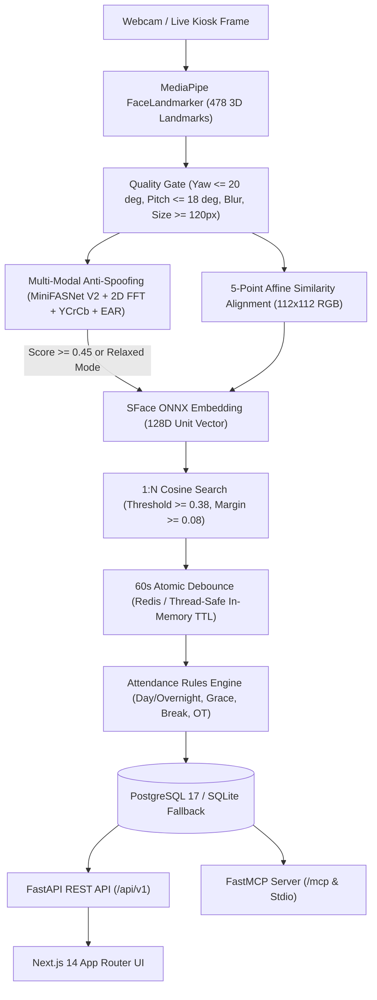

# AttendAI — System Architecture

This document describes the implemented architecture of **AttendAI**, covering the computer vision pipeline, anti-spoofing, attendance rules engine, FastAPI backend, FastMCP server, data model, and privacy/RBAC controls.

---

## 1. High-Level Architecture

---

## 2. Computer Vision & Anti-Spoofing Pipeline

Implemented in `backend/app/cv/`:

1. **Detection & Landmarks (`detector.py`)**
   - Uses **MediaPipe FaceLandmarker** (`face_landmarker.task`) outputting 478 3D landmarks and facial transformation matrices.
   - Evaluates bounding box size (`MIN_FACE_SIZE_PX = 120`), head pose (`MAX_YAW_ANGLE_DEG = 20.0`, `MAX_PITCH_ANGLE_DEG = 18.0`), Laplacian blur variance, illumination brightness, and Eye Aspect Ratio (EAR).
2. **Canonical Face Alignment (`alignment.py`)**
   - Extracts 5 canonical keypoints (left eye, right eye, nose tip, left mouth corner, right mouth corner) and applies a similarity transform to produce an aligned `112x112` RGB crop.
3. **Multi-Modal Anti-Spoofing (`anti_spoofing.py`)**
   - Combines **MiniFASNet V2 ONNX** (`minifasnet_v2.onnx`, `80x80` input) with 2D FFT high-frequency texture analysis, YCrCb skin chrominance divergence, and EAR eye openness (`LIVENESS_THRESHOLD = 0.45`).
4. **Feature Extraction & 1:N Matching (`recognition.py`)**
   - Extracts a `128D` L2-normalized embedding via **OpenCV SFace ONNX** (`face_recognition_sface.onnx`).
   - Performs 1:N cosine similarity search against active `FaceTemplate` records using `FACE_RECOGNITION_THRESHOLD = 0.38` and `FACE_AMBIGUITY_MARGIN = 0.08` to reject unknown or ambiguous matches.

---

## 3. Attendance Rules Engine & Debounce

Implemented in `backend/app/services/attendance_engine.py` and `backend/app/core/cache.py`:

- **Duplicate Punch Protection:** Atomic TTL lock (`PUNCH_DEBOUNCE_SECONDS = 60`) backed by Redis with an automatic thread-safe in-memory TTL fallback.
- **Overnight Shift Boundary:** If `shift.is_overnight` is enabled and a punch arrives before `shift.shift_day_boundary`, the punch resolves to the previous business day.
- **Check-In / Check-Out Aggregation:** First punch of the business date records `CHECK_IN` and computes `late_minutes` against `grace_period_mins` (`PRESENT`, `LATE`, or `HALF_DAY` when exceeding `half_day_late_mins`). Subsequent punches update `CHECK_OUT`, net `total_work_minutes` (deducting `break_duration_mins` when gross duration >= 300 minutes), `early_departure_minutes`, and `overtime_minutes`.
- **Leaves & Regularization:** Approved leaves synchronize `ON_LEAVE` records on `DailyAttendance`. Manual overrides and reviewed correction requests recalculate shift metrics and write immutable diffs to `AuditLog`.

---

## 4. Backend API, FastMCP & Persistence

- **FastAPI (`backend/app/main.py` & `backend/app/api/`):** Exposes versioned REST endpoints under `/api/v1` for auth, dashboard KPIs, employees, biometric enrollment, attendance, shifts, leaves, holidays, statutory CSV reports (Form 9 / APPI), and organization settings.
- **FastMCP (`backend/app/mcp/` & `backend/mcp_server.py`):** Mounted at `/mcp` via Streamable HTTP and runnable standalone over `stdio`. See [mcp-guide.md](mcp-guide.md).
- **Database (`backend/app/core/database.py` & `backend/app/models/`):** SQLAlchemy 2.0 ORM connecting to PostgreSQL (`DATABASE_URL`) with automatic SQLite fallback (`attendance_dev.db`) when Postgres is unavailable.
  - Core models: `Organization`, `Branch`, `Department`, `Shift`, `Employee`, `FaceTemplate`, `BiometricConsent`, `AttendanceLog`, `DailyAttendance`, `LeaveRequest`, `Holiday`, `RegularizationRequest`, `User`, `Role`, `Permission`, `AuditLog`, `SystemSetting`.

---

## 5. Privacy, Security & RBAC

- **Zero Raw Image Storage:** Camera snapshots used during enrollment or kiosk verification are processed in memory and discarded immediately; only `128D` unit vectors (`FaceTemplate`) are persisted.
- **Soft Deactivation:** Deactivating an employee marks `Employee.status = "INACTIVE"` and sets `FaceTemplate.is_active = False` so deactivated staff cannot check in.
- **JWT & RBAC (`backend/app/core/security.py`, `backend/app/api/deps.py`):** Passwords are hashed with `bcrypt`, sessions use `HS256` JWTs, and routes/MCP tools enforce four roles:
  - `ADMIN`: Full system, organization, user/role, preference, and HR operations.
  - `HR_MANAGER`: Employee directory, biometrics, shifts, attendance, leaves, regularizations, holidays, and reports.
  - `LINE_MANAGER`: Team attendance, directory read access, leave/regularization approvals, audit logs, and CSV exports.
  - `EMPLOYEE`: Self-scoped daily logs, attendance history, leave applications, correction requests, and monthly summary.

